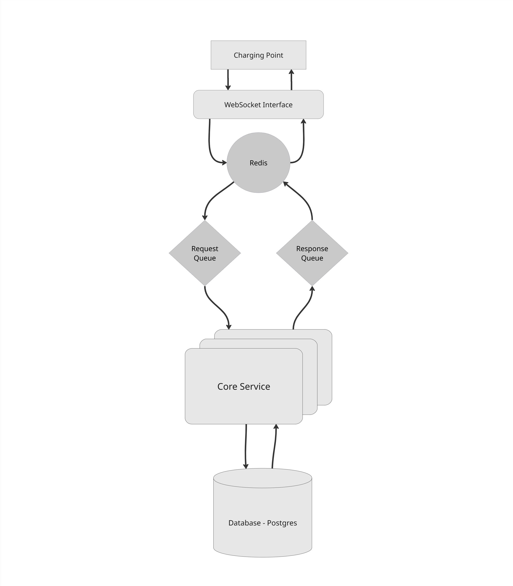

  

 

# Medinilla - An OCPP Compliant Management System

Medinilla is a CSMS backend built on top of ASP .NET Core. It aims to be a comprehensive, modular platform upon which you can build EV charging solutions.

Currently implemented OCPP messages:
- Boot Notification
- Heartbeat
- Security Event Notification
- Authorize
- Status Notification
- Transaction Event
- Notify Report
- Set Variables
- Get Variables
- Get Base Report
- Request Start Transaction
- Request Stop Transaction

For a rough per-message and per-use-case coverage breakdown see [`docs/ocpp-coverage.md`](docs/ocpp-coverage.md).

## Medinilla - Architecture
The most fundamental idea behind the architectural decisions on this project was scalability, and fault tolerance.

  

## Work overview
Actions have been implemented using the following Charging Station emulators:
1. https://github.com/extrawest/Charge-Point-Simulator-via-OCPP-2.0.1
2. https://evlab.i4b.pl/
3. [EVerest](https://github.com/everest)
